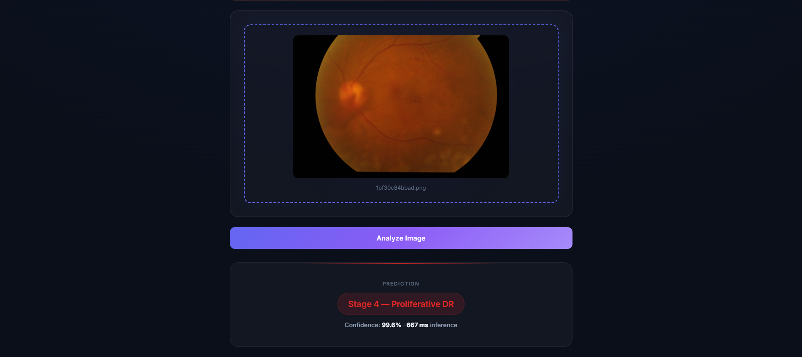
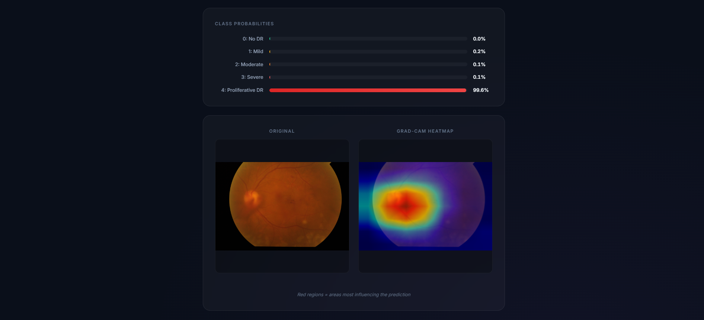
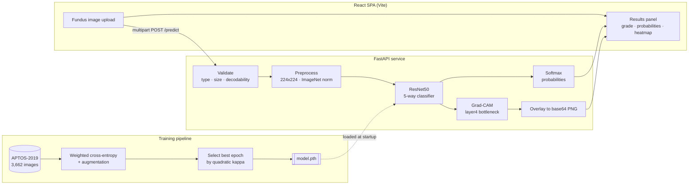
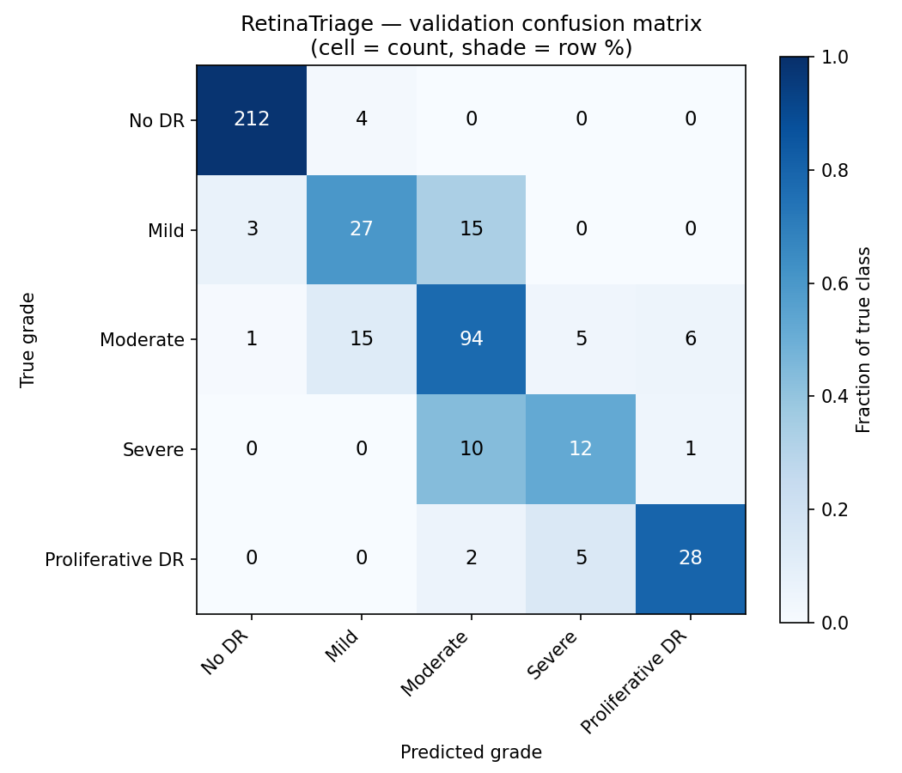

# RetinaTriage

Diabetic retinopathy grading from fundus images using ResNet50 and Grad-CAM, with a FastAPI backend and a React frontend.

Note: this is a research/educational project and not a medical device. It has not been validated on a clinical population, has no regulatory clearance, and should not be used for diagnosis or treatment. See the [Model Card](docs/MODEL_CARD.md) for limitations and risks.

## Overview

Diabetic retinopathy is a leading cause of preventable blindness in working-age adults. It is diagnosed by grading retinal photos, which needs a trained ophthalmologist and doesn't scale well to screening.

RetinaTriage takes a fundus photo and returns the DR grade (0-4), the probability for each grade, and a Grad-CAM heatmap showing which regions of the retina influenced the prediction.


Upload screen, with the non-clinical disclaimer shown.



A held-out grade 4 eye, graded Stage 4: Proliferative DR at 99.6% confidence in 667 ms.



The same prediction with the full probability distribution and the Grad-CAM overlay.

## Main points

- Model selection uses quadratic weighted kappa instead of accuracy, because grades are ordered and predicting stage 0 for a stage 4 eye should cost more than predicting stage 3. There is [a test](tests/test_training.py) for this.
- Grade 0 is about half of APTOS-2019, so training uses inverse-frequency weighted cross-entropy.
- Grad-CAM runs on every prediction, on the last bottleneck of `layer4` for the predicted class.
- If no weights are present the API still works but sets `untrained_warning` on every response and the UI shows a banner.
- FastAPI loads the model once at startup and reports latency per request. The React client uses a documented JSON format.
- Seeded splits and RNGs. `evaluate.py` rebuilds the same validation split from the seed and writes metrics as JSON plus a confusion matrix PNG.

## Architecture



The validation transform in `training/train.py` and the inference transform in `backend/model.py` have to stay the same, otherwise predictions get worse without any error. [A test](tests/test_training.py) checks this.

## Running

### Docker

```bash
docker compose up --build
```

UI at http://localhost:5173, API at http://localhost:8000, API docs at http://localhost:8000/docs.

### Locally

Backend:

```bash
cd backend
pip install -r requirements.txt
uvicorn main:app --reload --port 8000
```

Frontend (second terminal):

```bash
cd frontend
npm install
npm run dev
```

Then open http://localhost:5173.

Without trained weights it still runs. The API falls back to the ImageNet backbone, sets `untrained_warning: true`, and the UI shows a banner. This is enough to test the whole pipeline before training.

## Training

Dataset download, Colab setup and all CLI options are in [training/README.md](training/README.md).

```bash
cd training
pip install -r requirements.txt

# quick end to end check, under a minute, no GPU
python train.py --data_dir data/ --smoke_test --out ../backend/weights/model.pth

# full run (~30-45 min on a Colab T4)
python train.py --data_dir data/ --epochs 15 --batch_size 32 --lr 1e-4 \
    --out ../backend/weights/model.pth
```

Saves the best checkpoint by validation kappa and a `metrics.json` with the per-epoch history, confusion matrix and per-class report.

### Evaluation

```bash
cd training
python evaluate.py --data_dir data/ --weights ../backend/weights/model.pth --out_dir reports/
```

Reports quadratic weighted kappa, per-class precision/recall/F1, the confusion matrix, and referable-DR sensitivity/specificity (grade >= 2 vs < 2). Writes `reports/eval_metrics.json` and `reports/confusion_matrix.png`.

### Results

Best epoch (14 of 15) on a held-out validation split of 440 images, selected by kappa:

| Metric | Value |
| --- | --- |
| Quadratic weighted kappa | 0.9361 |
| Accuracy | 0.8477 |
| Referable-DR sensitivity (grade >= 2) | 0.9106 |
| Referable-DR specificity | 0.9425 |
| Macro F1 | 0.74 |



Per class:

| Grade | Precision | Recall | F1 | Support |
| --- | --- | --- | --- | --- |
| No DR | 0.98 | 0.98 | 0.98 | 216 |
| Mild | 0.59 | 0.60 | 0.59 | 45 |
| Moderate | 0.78 | 0.78 | 0.78 | 121 |
| Severe | 0.55 | 0.52 | 0.53 | 23 |
| Proliferative DR | 0.80 | 0.80 | 0.80 | 35 |

Kappa of 0.94 with macro F1 of 0.74 is expected here. The model is very good on No DR and decent on the most severe grades, but weak on Mild and Severe, which are also the grades clinicians disagree on most. Most errors are off by one grade, which quadratic weighting barely penalises. Only 8 of 440 predictions are off by two or more.

For screening the key number is referable-DR sensitivity, 0.9106: the model caught 91% of eyes that needed referral. The other 9% are false negatives, and in practice the decision threshold would be tuned against that.

These numbers come from a seeded random split of the training CSV, not the competition test set, so they can't be compared with Kaggle leaderboard scores. A random split shares acquisition conditions with training data and is easier. APTOS also has near-duplicate images and the split is per image, not per patient, so the numbers are likely somewhat optimistic. See the [Model Card](docs/MODEL_CARD.md) for the full breakdown.

Raw outputs from this run: [eval_metrics.json](docs/results/eval_metrics.json) (validation metrics and confusion matrix) and [training_history.json](docs/results/training_history.json) (loss, accuracy and kappa for all 15 epochs).

## DR grades

| Grade | Label | Description |
| --- | --- | --- |
| 0 | No DR | No signs of diabetic retinopathy |
| 1 | Mild | Mild nonproliferative DR (microaneurysms only) |
| 2 | Moderate | Moderate nonproliferative DR |
| 3 | Severe | Severe nonproliferative DR |
| 4 | Proliferative DR | Neovascularisation present |

## API

OpenAPI docs are at `/docs`.

| Method | Route | Purpose |
| --- | --- | --- |
| `GET` | `/` | service info and class list |
| `GET` | `/health` | status, device, and whether real weights are loaded |
| `POST` | `/predict` | grade a fundus image (`multipart/form-data`, field `file`) |

```bash
curl -X POST http://localhost:8000/predict -F "file=@fundus.png"
```

```json
{
  "stage": 2,
  "stage_label": "Moderate",
  "confidence": 0.87,
  "probabilities": {
    "No DR": 0.02, "Mild": 0.05, "Moderate": 0.87,
    "Severe": 0.04, "Proliferative DR": 0.02
  },
  "heatmap": "<base64 encoded PNG>",
  "inference_ms": 143.2,
  "untrained_warning": false
}
```

Errors: `400` unreadable image, `413` file too large, `415` unsupported type, `422` no file, `500` inference failure, `503` model still loading.

### Configuration

All optional, each has a local default.

| Variable | Default | Purpose |
| --- | --- | --- |
| `RETINATRIAGE_WEIGHTS` | `backend/weights/model.pth` | checkpoint path |
| `RETINATRIAGE_ALLOWED_ORIGINS` | `http://localhost:5173` | comma-separated CORS origins |
| `RETINATRIAGE_MAX_UPLOAD_MB` | `10` | upload size limit |
| `RETINATRIAGE_FORCE_CPU` | unset | use CPU even if a GPU is available |
| `VITE_API_BASE` (frontend) | `http://localhost:8000` | backend URL, set at build time |

## Tests

```bash
pip install -r backend/requirements.txt -r training/requirements.txt -r requirements-dev.txt
pytest
```

The API tests stub the ResNet50 backbone, so they run in seconds without a GPU, weights or an ImageNet download, but still go through the real validation, preprocessing and response code. They cover the response format, the untrained flag, every error code, and that internal errors aren't returned to the client. The training tests cover class weights, split reproducibility, kappa vs accuracy, and the train/inference preprocessing match.

Lint with `ruff check .` (Python) and `npm run lint` (frontend). Both run in CI on every push and PR.

## Structure

```
retinatriage/
├── backend/                 FastAPI service
│   ├── main.py              routes, validation, error handling
│   ├── model.py             ResNet50 and preprocessing
│   ├── gradcam.py           Grad-CAM overlay
│   ├── config.py            settings from environment
│   └── weights/             model.pth goes here (gitignored)
├── training/
│   ├── train.py             weighted CE, kappa-based selection
│   ├── evaluate.py          QWK, confusion matrix, referable-DR metrics
│   └── README.md            dataset and training guide
├── frontend/                React (Vite) UI
│   └── src/App.jsx          upload, analysis, results
├── tests/                   pytest (API and training)
├── docs/MODEL_CARD.md       intended use, data, metrics, risks
├── .github/workflows/ci.yml lint and tests
└── docker-compose.yml       full stack
```

## Stack

| Layer | Technology |
| --- | --- |
| Frontend | React 19, Vite, CSS |
| Backend | FastAPI, Uvicorn |
| ML | PyTorch, torchvision (ResNet50) |
| Explainability | pytorch-grad-cam |
| Data | APTOS 2019 Blindness Detection (Kaggle) |
| Metrics | scikit-learn (quadratic weighted kappa) |
| Tooling | pytest, ruff, Oxlint, Docker, GitHub Actions |

## References

- [APTOS 2019 Blindness Detection](https://www.kaggle.com/competitions/aptos2019-blindness-detection), Aravind Eye Hospital
- Selvaraju et al., [Grad-CAM: Visual Explanations from Deep Networks via Gradient-based Localization](https://arxiv.org/abs/1610.02391) (2017)
- He et al., [Deep Residual Learning for Image Recognition](https://arxiv.org/abs/1512.03385) (2015)

## License

MIT, Abhiram Radhakrishnan. See [LICENSE](LICENSE). For educational and research use only.
