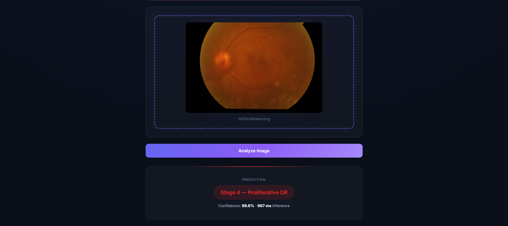
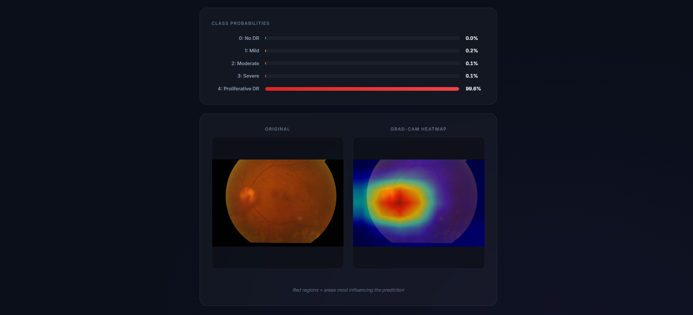
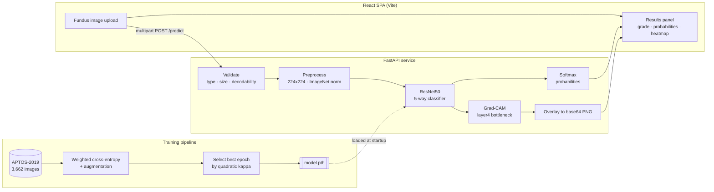
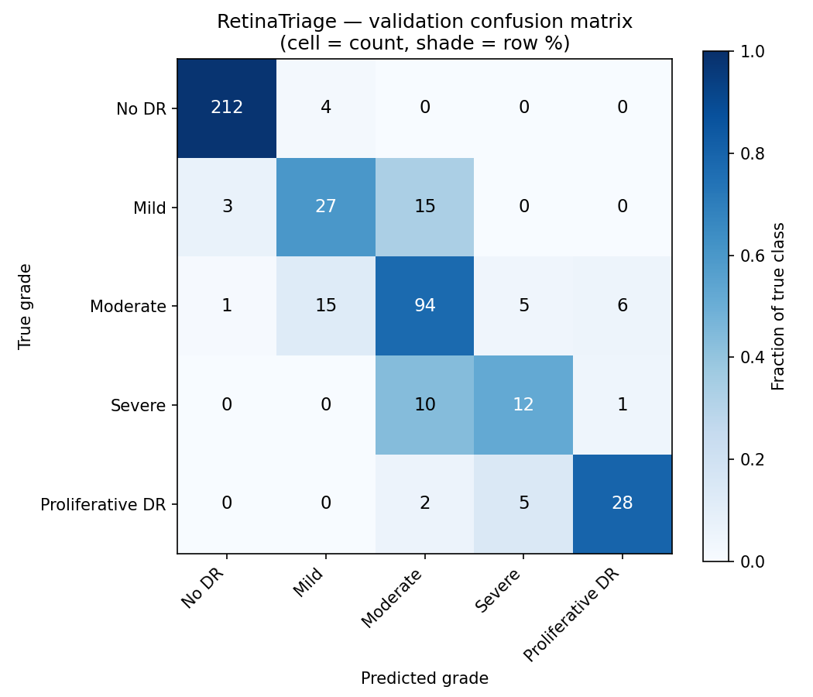

<div align="center">

# RetinaTriage 

**Explainable diabetic retinopathy screening - ResNet50 staging with Grad-CAM, served end to end.**

[](https://github.com/24f1002043/retinatriage/actions/workflows/ci.yml)
[](https://www.python.org/)
[](https://pytorch.org/)
[](https://fastapi.tiangolo.com/)
[](https://react.dev/)
[](LICENSE)

</div>

> [!WARNING]
> **Research and educational project, not a medical device.** Never validated on
> a clinical population, no regulatory clearance, and not for any diagnostic or
> treatment decision. See the [Model Card](docs/MODEL_CARD.md) for the full
> limitations, risks, and ethical considerations.

---

## What it does

Diabetic retinopathy is the leading cause of preventable blindness in working-age
adults, and it is diagnosed by grading retinal photographs - a task that needs a
trained ophthalmologist and doesn't scale to the population that needs screening.

RetinaTriage takes a fundus photograph and returns **the DR grade (0–4), the full
probability distribution across grades, and a Grad-CAM heatmap showing which
retinal regions drove that grade** , because a screening prediction a clinician
can't interrogate is a prediction they can't act on.

<div align="center">
  
  <br><em>Drag-and-drop upload, with the non-clinical-use disclaimer always in view.</em>
</div>

<br>

<div align="center">
  
  <br><em>A held-out grade-4 eye, correctly graded <strong>Stage 4 — Proliferative DR</strong>
  at 99.6% confidence in 667 ms.</em>
</div>

<br>

<div align="center">
  
  <br><em>The same prediction in full: the distribution across all five grades, and the
  Grad-CAM overlay marking the regions that drove it.</em>
</div>


---

## Highlights

| | |
| --- | --- |
| **Ordinal-aware modelling** | DR grades are ordered, so the model is selected on **quadratic weighted kappa**, not accuracy - grading a stage-4 eye as stage 0 is penalised far more than grading it stage 3. Accuracy cannot see that difference; [a test asserts exactly this](tests/test_training.py). |
| **Handles severe class imbalance** | Grade 0 is ~half of APTOS-2019. Training uses **inverse-frequency weighted cross-entropy** so the rare sight-threatening grades aren't drowned out by the majority class. |
| **Explainable by default** | Grad-CAM runs on *every* prediction, not as an optional extra - targeting `layer4`'s final bottleneck for the predicted class. |
| **Honest about untrained state** | With no weights present the API still serves, but flags `untrained_warning` on every response and the UI shows a banner - a demo screenshot can never be mistaken for a real result. |
| **Real-time REST inference** | FastAPI loads the model once at startup and reports per-request latency; the React client consumes it over a documented JSON contract. |
| **Reproducible** | Seeded splits and RNGs; `evaluate.py` rebuilds the exact validation split from the seed and emits metrics as JSON plus a confusion-matrix PNG. |

---

## Architecture



The validation transform in `training/train.py` and the inference transform in
`backend/model.py` **must** stay identical - a silent divergence would degrade
every prediction without raising an error, so
[a test enforces it](tests/test_training.py).

---

## Quick start

### Option A - Docker (everything, one command)

```bash
docker compose up --build
```

UI on <http://localhost:5173>, API on <http://localhost:8000>, interactive API
docs on <http://localhost:8000/docs>.

### Option B - Run locally

**Backend**

```bash
cd backend
pip install -r requirements.txt
uvicorn main:app --reload --port 8000
```

**Frontend** (in a second terminal)

```bash
cd frontend
npm install
npm run dev
```

Then open <http://localhost:5173>.

> **No trained weights?** It still runs. The API falls back to the ImageNet
> backbone, sets `untrained_warning: true`, and the UI banners it. That's enough
> to verify the whole pipeline end to end before you train anything.

---

## Training

Full walkthrough - Kaggle dataset download, Colab GPU setup, all CLI flags - in
**[`training/README.md`](training/README.md)**.

```bash
cd training
pip install -r requirements.txt

# Verify the pipeline end to end in under a minute, no GPU needed
python train.py --data_dir data/ --smoke_test --out ../backend/weights/model.pth

# Full run (~30–45 min on a Colab T4)
python train.py --data_dir data/ --epochs 15 --batch_size 32 --lr 1e-4 \
    --out ../backend/weights/model.pth
```

Training writes the best checkpoint by validation kappa, plus a `metrics.json`
containing the per-epoch history, confusion matrix, and per-class report.

### Evaluation

```bash
cd training
python evaluate.py --data_dir data/ --weights ../backend/weights/model.pth --out_dir reports/
```

Reports quadratic weighted kappa, per-class precision/recall/F1, the confusion
matrix, and referable-DR sensitivity/specificity (grades ≥ 2 vs < 2) - the view
closest to how a screening tool is actually judged. Writes
`reports/eval_metrics.json` and `reports/confusion_matrix.png`.

### Results

Best epoch (14 of 15) on a held-out 440-image validation split, selected by kappa:

| Metric | Value |
| --- | --- |
| **Quadratic weighted kappa** | **0.9361** |
| Accuracy | 0.8477 |
| Referable-DR sensitivity (grade ≥ 2) | 0.9106 |
| Referable-DR specificity | 0.9425 |
| Macro-averaged F1 | 0.74 |

<div align="center">
  
</div>

**Per-class performance is where the real story is:**

| Grade | Precision | Recall | F1 | Support |
| --- | --- | --- | --- | --- |
| No DR | 0.98 | 0.98 | 0.98 | 216 |
| Mild | 0.59 | 0.60 | 0.59 | 45 |
| Moderate | 0.78 | 0.78 | 0.78 | 121 |
| Severe | 0.55 | 0.52 | 0.53 | 23 |
| Proliferative DR | 0.80 | 0.80 | 0.80 | 35 |

A headline kappa of 0.94 alongside a macro-F1 of 0.74 is not a contradiction ,
it's the whole reason kappa is the metric here. The model is near-perfect on
"No DR" and solid on the sight-threatening extremes, but genuinely weak on
**Mild** and **Severe**, the two boundary grades that clinicians also disagree
on most. Almost every error is off by a single grade, which quadratic weighting
barely penalises; only 8 of 440 predictions are off by two or more.

For screening, the number that matters is referable-DR **sensitivity: 0.9106** -
of the eyes that genuinely warranted referral, the model caught 91%. The
remaining 9% are false negatives, and in a real deployment that, not accuracy,
is what the decision threshold would be tuned against.

> **How to read these numbers.** This is a seeded random split of the training
> CSV, not the competition's held-out test set, so it is **not** comparable to
> Kaggle leaderboard scores , a random split shares acquisition conditions with
> the training data and is a substantially easier target. APTOS is also known to
> contain near-duplicate images, and the split is per-image rather than
> per-patient, so some optimistic bias should be assumed. Reproduce with
> `evaluate.py`; full breakdown in the [Model Card](docs/MODEL_CARD.md).

Raw output from the run above is committed verbatim:
[`eval_metrics.json`](docs/results/eval_metrics.json) (validation metrics and
confusion matrix) and [`training_history.json`](docs/results/training_history.json)
(per-epoch loss, accuracy, and kappa for all 15 epochs).

---

## DR grades

| Grade | Label | Description |
| --- | --- | --- |
| 0 | No DR | No signs of diabetic retinopathy |
| 1 | Mild | Mild nonproliferative DR (microaneurysms only) |
| 2 | Moderate | Moderate nonproliferative DR |
| 3 | Severe | Severe nonproliferative DR |
| 4 | Proliferative DR | Neovascularisation present |

---

## API

Interactive OpenAPI docs are served at `/docs`.

| Method | Route | Purpose |
| --- | --- | --- |
| `GET` | `/` | Service metadata and class list |
| `GET` | `/health` | Liveness, device, and whether real weights are loaded |
| `POST` | `/predict` | Grade a fundus image (`multipart/form-data`, field `file`) |

```bash
curl -X POST http://localhost:8000/predict -F "file=@fundus.png"
```

```json
{
  "stage": 2,
  "stage_label": "Moderate",
  "confidence": 0.87,
  "probabilities": {
    "No DR": 0.02, "Mild": 0.05, "Moderate": 0.87,
    "Severe": 0.04, "Proliferative DR": 0.02
  },
  "heatmap": "<base64 encoded PNG>",
  "inference_ms": 143.2,
  "untrained_warning": false
}
```

**Errors:** `400` unreadable image · `413` over the size limit · `415`
unsupported type · `422` no file · `500` inference failure · `503` model still loading.

### Configuration

All optional — every value has a working local default.

| Variable | Default | Purpose |
| --- | --- | --- |
| `RETINATRIAGE_WEIGHTS` | `backend/weights/model.pth` | Checkpoint location |
| `RETINATRIAGE_ALLOWED_ORIGINS` | `http://localhost:5173` | Comma-separated CORS origins |
| `RETINATRIAGE_MAX_UPLOAD_MB` | `10` | Upload size limit |
| `RETINATRIAGE_FORCE_CPU` | unset | Force CPU inference even with a GPU present |
| `VITE_API_BASE` (frontend) | `http://localhost:8000` | Backend base URL, inlined at build time |

---

## Tests

```bash
pip install -r backend/requirements.txt -r training/requirements.txt -r requirements-dev.txt
pytest
```

The API tests stub the ResNet50 backbone, so the suite runs in seconds with no
GPU, no trained weights, and no ImageNet download , while still exercising the
real validation, preprocessing, and response path. They cover the response
contract, the untrained-mode flag, every error status, and that internal error
detail never leaks to the client. The training tests cover class weighting,
split reproducibility, why kappa is used over accuracy, and the
training/inference preprocessing contract.

Lint with `ruff check .` (Python) and `npm run lint` (frontend). Both run in CI
on every push and pull request.

---

## Project structure

```
retinatriage/
├── backend/                 # FastAPI inference service
│   ├── main.py              # Routes, validation, error handling
│   ├── model.py             # ResNet50 + inference preprocessing
│   ├── gradcam.py           # Grad-CAM overlay generation
│   ├── config.py            # Environment-driven settings
│   └── weights/             # model.pth goes here (gitignored)
├── training/                # Model pipeline
│   ├── train.py             # Weighted CE, kappa-based selection
│   ├── evaluate.py          # QWK, confusion matrix, referable-DR metrics
│   └── README.md            # Dataset + training guide
├── frontend/                # React (Vite) single-page UI
│   └── src/App.jsx          # Upload, analysis, results
├── tests/                   # pytest suite (API + training logic)
├── docs/MODEL_CARD.md       # Intended use, data, metrics, risks
├── .github/workflows/ci.yml # Lint + test, both stacks
└── docker-compose.yml       # Full stack, one command
```

---

## Tech stack

| Layer | Technology |
| --- | --- |
| Frontend | React 19, Vite, vanilla CSS |
| Backend | FastAPI, Uvicorn |
| ML | PyTorch, torchvision (ResNet50) |
| Explainability | pytorch-grad-cam |
| Data | APTOS 2019 Blindness Detection (Kaggle) |
| Metrics | scikit-learn (quadratic weighted kappa) |
| Tooling | pytest, ruff, Oxlint, Docker, GitHub Actions |

---

## Acknowledgements

- [APTOS 2019 Blindness Detection](https://www.kaggle.com/competitions/aptos2019-blindness-detection) — Aravind Eye Hospital
- Selvaraju et al., [*Grad-CAM: Visual Explanations from Deep Networks via Gradient-based Localization*](https://arxiv.org/abs/1610.02391) (2017)
- He et al., [*Deep Residual Learning for Image Recognition*](https://arxiv.org/abs/1512.03385) (2015)

## License

MIT © Abhiram Radhakrishnan - see [LICENSE](LICENSE).

For educational and research purposes only.
